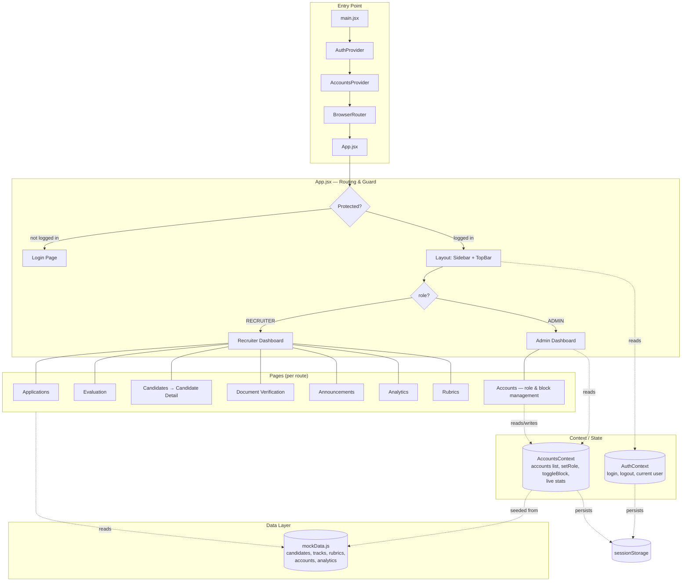

# 🛡️ ScreenAI Lab — Cyber Security Recruitment Portal

Portal rekrutmen internal untuk **MBC Laboratory**, khusus divisi **Cyber Security**. Aplikasi ini mensimulasikan seluruh alur seleksi kandidat — mulai dari pendaftaran, verifikasi dokumen, evaluasi berbasis AI, hingga pengumuman hasil — dengan dua peran pengguna utama: **Recruiter** dan **Admin**.

> Status: **frontend prototype**. Semua data (kandidat, akun, skor, dokumen) adalah *mock data* yang di-generate secara deterministik di sisi klien — belum terhubung ke database/backend sungguhan.

---

## 📌 Apa Fungsinya?

Portal ini mensimulasikan sistem rekrutmen berbasis AI untuk empat *track* di bawah divisi Cyber Security:

- **Red Team / Offensive**
- **Blue Team / SOC**
- **Digital Forensics**
- **Application Security**

Alur seleksi yang disimulasikan:

```
Kandidat mendaftar
      │
      ▼
Verifikasi Dokumen  (CV, KHS, KTM, Motivation Letter, SWOT, dll.)
      │
      ▼
Evaluasi AI per Track  (skor per dimensi kompetensi + justifikasi + bukti)
      │
      ▼
Review & Validasi Recruiter  (ranking, radar kompetensi, catatan validasi)
      │
      ▼
Pengumuman Pass / Fail  (checklist keamanan sebelum publish)
```

### Fungsi untuk role **Recruiter**
| Halaman | Fungsi |
|---|---|
| **Dashboard** | Ringkasan antrian kerja, statistik divisi, breakdown per track |
| **Applications** | Daftar aplikasi masuk, status dokumen, filter per track/status |
| **Evaluation** | Menjalankan evaluasi AI per track, melihat progres & kriteria bobot |
| **Candidates** | Kandidat yang sudah dievaluasi, diurutkan berdasarkan skor |
| **Candidate Detail** | Profil lengkap kandidat: radar kompetensi, breakdown skor per dimensi, justifikasi & bukti AI, checklist validasi |
| **Document Verification** | Verifikasi / minta perbaikan / tolak dokumen kandidat |
| **Announcements** | Checklist keamanan sebelum publish, tetapkan keputusan Pass/Fail per kandidat |
| **Analytics** | Funnel seleksi, distribusi skor, fakultas, jurusan, angkatan, IPK |
| **Rubrics** | Kelola bobot & indikator penilaian per dimensi, per track |
| **Profile** | Ringkasan akun recruiter |

### Fungsi untuk role **Admin**
Admin melihat **dashboard yang berbeda** — bukan alur rekrutmen, tapi **kontrol akun platform**:

| Halaman | Fungsi |
|---|---|
| **Admin Dashboard** | Statistik total akun terdaftar (total, kandidat, recruiter, admin), status akun (aktif/pending/blocked), tren registrasi |
| **Accounts** | Kelola semua akun: **naikkan/turunkan role** (Candidate ⇄ Recruiter ⇄ Admin), **block/unblock** akun. Admin tidak bisa mengubah/blokir akunnya sendiri |

Login mendukung toggle **"Sign in as: Recruiter / Admin"** untuk mendemonstrasikan kedua sudut pandang tanpa akun terpisah.

---

## 🧰 Tech Stack

| Layer | Tools |
|---|---|
| Framework UI | **React 18** |
| Build tool | **Vite 5** |
| Routing | **React Router 6** |
| Ikon | **lucide-react** |
| Styling | CSS murni (custom design system, CSS variables) — tanpa Tailwind/UI kit |
| State management | React Context API (`AuthContext`, `AccountsContext`) |
| Persistensi sesi | `sessionStorage` (login & perubahan akun bertahan selama sesi browser) |
| Data | Mock data generator (`src/data/mockData.js`) — tidak ada backend/database |

Tidak ada dependency backend (Node server, database) — seluruh aplikasi adalah **static SPA** yang bisa di-build menjadi file HTML/CSS/JS statis.

---

## 🏗️ Arsitektur



### Struktur folder

```
src/
├─ main.jsx                 # Bootstrap: providers + router
├─ App.jsx                  # Route definitions, auth guard, role-based home
├─ components/
│  ├─ Layout.jsx            # Shell: sidebar + topbar + halaman aktif
│  ├─ Sidebar.jsx            # Navigasi, berbeda untuk Recruiter vs Admin
│  ├─ TopBar.jsx             # Info periode aktif + identitas user
│  ├─ Logo.jsx               # Logo SVG
│  └─ RadarChart.jsx         # Chart radar kompetensi (SVG murni, tanpa library chart)
├─ context/
│  ├─ AuthContext.jsx        # Login/logout, role user aktif
│  └─ AccountsContext.jsx    # State akun: ubah role, block/unblock, statistik live
├─ data/
│  └─ mockData.js            # Sumber data tunggal: kandidat, track, rubrik, akun, analytics
├─ pages/                    # Satu file per halaman/route
├─ styles/
│  └─ index.css              # Design system (variabel warna merah-putih, komponen UI)
└─ utils/
   └─ format.js              # Helper kecil (kelas warna status/skor)
```

### Alur data
1. **`mockData.js`** menghasilkan seluruh data dummy secara deterministik (nama kandidat, skor, dokumen, dst.) menggunakan fungsi hash sederhana — sehingga data selalu konsisten antar reload.
2. **Context** (`AuthContext`, `AccountsContext`) menyimpan *state* yang bisa berubah saat runtime (siapa yang login, perubahan role/block akun), disinkronkan ke `sessionStorage` agar tidak hilang saat pindah halaman.
3. **Pages** membaca data dari `mockData.js` (statis) atau dari context (dinamis), lalu merender UI menggunakan komponen bersama di `components/`.
4. Tidak ada pemanggilan API/network — semua kalkulasi (statistik akun, breakdown skor, funnel) dilakukan di sisi klien secara real-time saat data context berubah.

---

## 🚀 Menjalankan Proyek

```bash
npm install
npm run dev       # buka http://localhost:5173
```

Build produksi:
```bash
npm run build
npm run preview
```

**Login demo**: pilih peran (**Recruiter** atau **Admin**) pada halaman login, lalu klik **Sign in** — kredensial sudah terisi otomatis.

---

## ⚠️ Catatan

- Ini adalah **prototipe frontend** untuk keperluan demo/portofolio — belum terhubung ke backend/database sungguhan.
- Seluruh data kandidat, akun, dan skor bersifat **fiktif**, digenerate otomatis untuk keperluan tampilan.
- Perubahan role/block akun pada halaman Admin tersimpan di `sessionStorage` browser (hilang saat sesi berakhir), bukan di server.
